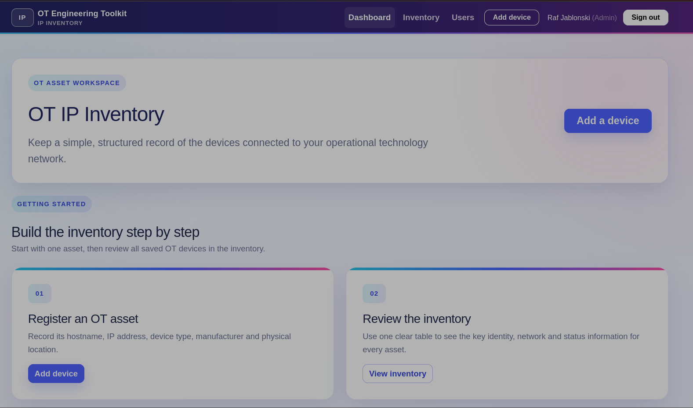
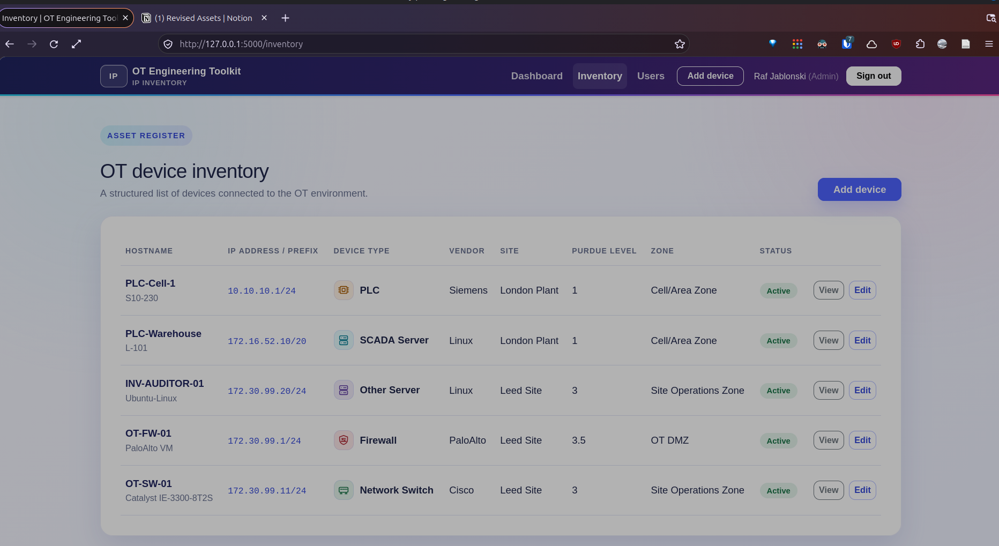

# OT Inventory

A Flask-based operational technology asset inventory for maintaining a clear,
structured record of industrial devices. The project demonstrates Python web
development, relational data modelling, authentication, role-based access and
deployment to PythonAnywhere.



## Features

- Secure sign-in and CSRF-protected forms
- Administrator, editor and viewer roles
- First-run administrator setup
- OT device records with hostname, IPv4 address and subnet prefix
- Device type, vendor, model and serial-number tracking
- Site, physical location and VLAN fields
- Purdue-level and security-zone classification
- Asset status and descriptive notes
- Database migrations with Flask-Migrate
- Public read-only demonstration using fictional asset data



## Technology

- Python and Flask
- SQLAlchemy and SQLite
- Flask-Login
- Flask-WTF and WTForms
- Alembic/Flask-Migrate
- HTML, CSS and JavaScript

## Local setup

Create and activate a Python virtual environment, then install the dependencies:

```bash
python -m venv .venv
source .venv/bin/activate
pip install -r requirements.txt
```

Create the local environment file, generate a secret key, then create the
database and start the application:

```bash
cp .env.example .env
python -c "import secrets; print(secrets.token_hex(32))"
# Paste the generated value after SECRET_KEY= in .env
flask --app run.py db upgrade
flask --app run.py run --debug
```

The `.env` file is excluded from Git and must never be committed. The public
demo is available at `http://127.0.0.1:5000/demo` without an account.

Open `http://127.0.0.1:5000/setup` to create the first administrator.

## Deployment

See [DEPLOYMENT.md](DEPLOYMENT.md) for the PythonAnywhere deployment and update
procedure.

## Security and data

Runtime databases, backups, secrets and local project documents are excluded
from version control. The repository contains application code and illustrative
screenshots only; it does not contain a production OT asset database.
